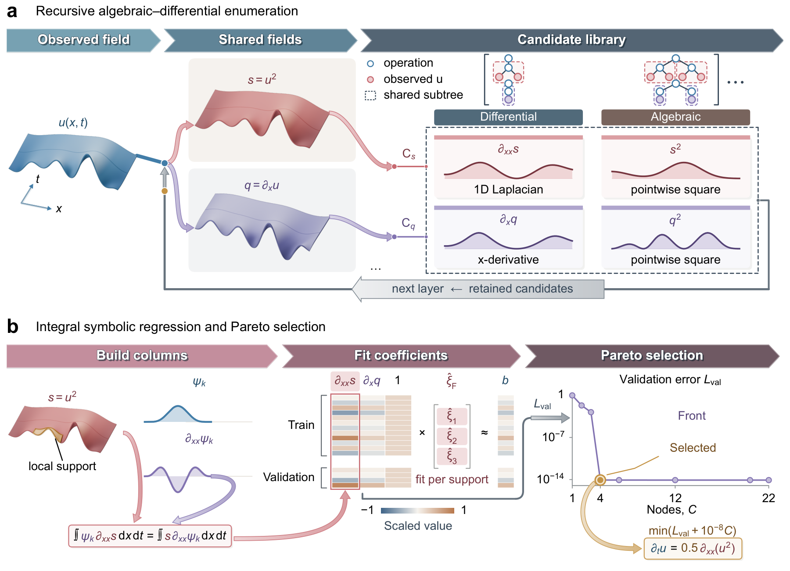

# SPADE

### Discovering partial differential equations through shared symbolic computation

Ziyuan Zhu\*, Keyu Hu\*, Yuhao Shi, Ming Bao, Yan Gao, Zhifei Chen and Minghui Lu

\*Equal contribution

[**Movies**](https://brianzhu1999.github.io/SPADE/) · [**Quick start**](#quick-start) · [**Reproduction guide**](docs/reproduce.md) · [**Study & data sources**](docs/study.md) · [**Citation**](#citation)

SPADE discovers partial differential equations from observed physical fields. It recursively constructs algebraic and differential expressions, reuses shared intermediate fields, and selects compact equations through weak-form evaluation and validation error.

**Shared-Subexpression Parallel Algebraic–Differential Enumeration** connects three operations:

- **Construct expressions.** Compose algebraic operations and spatial derivatives to represent nonlinear fluxes and nested differential operators.
- **Reuse computation.** Evaluate shared subexpressions once and reuse their fields and integral projections across candidates.
- **Select equations.** Fit coefficients on training observations, then balance validation error with expression complexity.

[](docs/assets/framework.pdf)

The study covers **16 numerical systems and six experimental systems**, including coupled three-dimensional conservation laws and eight scalar equations identified from measured fields. [Ten supplementary movies](https://brianzhu1999.github.io/SPADE/) follow the path from observations to discovered equations and predictive tests.

## Quick start

The repository includes the search engine, a Burgers dataset, the example configuration and an evaluated output. The commands below use **Python 3.12 and an NVIDIA CUDA GPU**.

```bash
git clone https://github.com/BrianZhu1999/SPADE.git
cd SPADE
python3.12 -m venv .venv
source .venv/bin/activate
python -m pip install torch==2.6.0 --index-url https://download.pytorch.org/whl/cu118
python -m pip install -r requirements.txt
python check_semantics.py
python run_spade_main.py --case Burgers --device cuda:0 --batch-id example
```

The input is a scalar field sampled at **201 times and 256 spatial points**. The configuration assigns a **300 s search budget**. The recovered equation has the form

$$u_t = 0.1\,u_{xx} - 0.5\,(u^2)_x,$$

where $u(x,t)$ is the observed field, $x$ is space and $t$ is time. Subscripts denote derivatives.

Results are written to `results/example/SPADE/Burgers/clean_core/seed0/`. Open `result.json` for the selected terms, coefficients, validation residual and error–complexity frontier. [Example output](examples/burgers-result.json) and the [reproduction guide](docs/reproduce.md) explain the records and verification steps.

## Repository map

| Path | Contents |
|---|---|
| [`core/`](core/) | Expression construction, shared evaluation, weak integration and equation selection |
| [`run_spade_main.py`](run_spade_main.py) | Entry point using the bundled configuration |
| [`spade_main_config.json`](spade_main_config.json) | Search operators, budgets and selection settings |
| [`data/Burgers/`](data/Burgers/) | Observed field, coordinates, data split and source license |
| [`examples/`](examples/) | Evaluated Burgers output and verification record |
| [`docs/reproduce.md`](docs/reproduce.md) | Environment, commands, data format and output interpretation |
| [`docs/study.md`](docs/study.md) | Paper figures, supplementary movies and experimental data references |
| [`check_semantics.py`](check_semantics.py) | Analytic checks for derivatives, integrals and shared computation |
| [`assets/`](assets/) | The ten movies and their covers |

## Citation

GitHub's **Cite this repository** menu exports the metadata in [`CITATION.cff`](CITATION.cff).

```bibtex
@software{zhu2026spade,
  author = {Zhu, Ziyuan and Hu, Keyu and Shi, Yuhao and Bao, Ming
            and Gao, Yan and Chen, Zhifei and Lu, Minghui},
  title  = {Discovering partial differential equations through shared symbolic computation},
  year   = {2026},
  url    = {https://github.com/BrianZhu1999/SPADE}
}
```

## License and data attribution

SPADE code is released under the [MIT License](LICENSE). The bundled Burgers data originate from [SGA-PDE](https://github.com/YuntianChen/SGA-PDE); its copyright notice and MIT license are preserved in [`data/Burgers/LICENSE`](data/Burgers/LICENSE). See [third-party attribution](THIRD_PARTY_NOTICES.md) and [experimental data sources](docs/study.md#data-sources).
